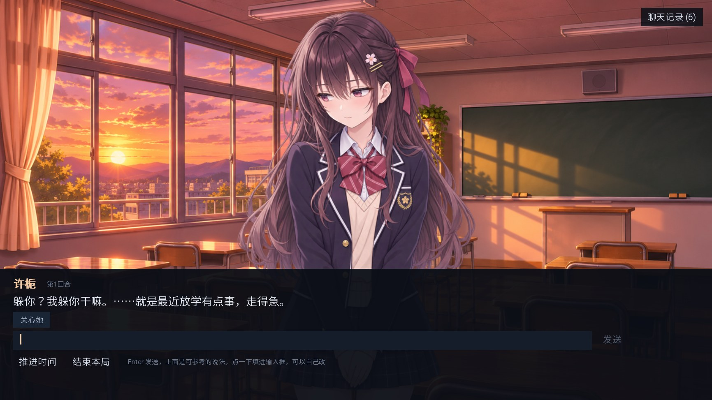
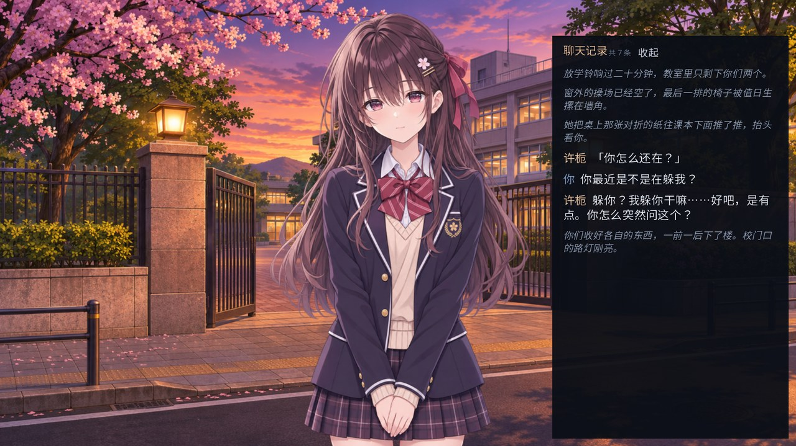
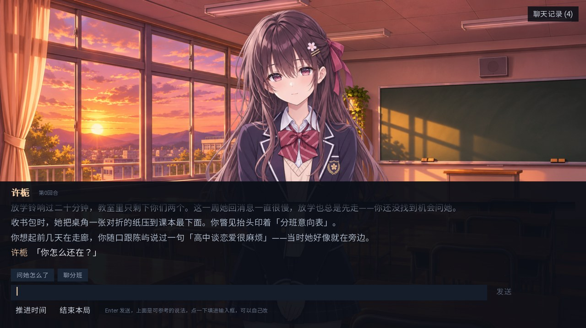

# 那天放学后 / After the Bell

一个以**自由输入对话**为主要交互的校园恋爱视觉小说 Demo。
AI 负责自然对白，**可验证的规则**负责世界事实、事件触发与结局判定。

- 当前状态：**v0.3 已完成**——在 M0–M3 基础上做了语义正确性、事件生命周期、读档时间线与动态叙事增强。
- 平台：Ren'Py 8.6 桌面版；通信为普通 HTTP/JSON（无 SSE）。



聊天记录从右上角按钮展开为右侧抽屉，不遮挡人物：



> v0.3 的逐项完成情况、迁移说明与剩余风险见 [docs/V0.3_ACCEPTANCE.md](docs/V0.3_ACCEPTANCE.md)。

---

## 0. v0.3 改了什么（一句话版）

- **语义不再被关键词带偏**：否定、引用、疑问、假设、主客体都会判断；「我不喜欢你」不会写入表白，
  「我希望你不要为了我放弃重点班」不会被判成控制。
- **事件不能一句话自动完成**：`active → interacting → resolved/abandoned`，必须有互动证据；无证据就等待，超时才放弃。
- **读档不会泄漏未来**：每次读档新开一个 `branch_id` 分支，只继承读档点之前的对话/记忆/事件。
- **许栀会主动**：白名单 `npc_intent`（问疏远/提分班/邀请同行/划边界），只排期、不直接完成事件。
- **未解决线索真的存在**：`open_threads` 三条线索从事实推导，进入导演 prompt 与打分。
- **目标与结局更严谨**：目标由 JSON 谓词驱动；`romance` 需要双方意愿与尊重，`friends` 不会被数值硬塞。

---

## 1. 30 秒上手

1. 复制 `.env.example` 为 `.env`，填入你的 `LLM_API_KEY`（DeepSeek 官方默认已配好）。
   `ATB_LLM_MODE=llm` 用真模型；`mock` 则离线跑模板对白。
2. 双击 **`run_dev.bat`**：起后端（独立窗口）→ 等 `/health` 就绪 → 打开游戏。

手动启动：

```powershell
# 终端 A：后端
cd D:\AfterTheBell\backend
..\.venv\Scripts\python.exe -m uvicorn app.main:app --host 127.0.0.1 --port 8756

# 终端 B：游戏
D:\renpy-8.6.0-sdk\renpy.exe D:\AfterTheBell
```

第一次从零搭环境：

```powershell
py -3.12 -m venv .venv
.venv\Scripts\python.exe -m pip install -r backend\requirements.txt
```

游戏里：在右侧输入框打字 → `发送`（或 Enter）；`推进时间` 相当于"结束这一幕/放学"；`结束本局` 回标题。
Esc 打开存档菜单。

---

## 2. 现在是什么状态

| 层 | 内容 |
|---|---|
| 客户端 | Ren'Py 8.6，中文 UI（内置思源黑体）；**女主居中**，底部对话区（角色对白 / 旁白 / 输入 / 建议回复），**右上角聊天记录按钮 → 右侧抽屉**，思考中提示，后端离线兜底，三种结局演出，读档快照对齐 |
| 角色 Agent | 真实 LLM（DeepSeek `deepseek-chat`，OpenAI 兼容），JSON 输出 + 校验 + 语气兜底 + 重试；`mock` 模式可离线 |
| 导演 | LLM 在规则已过滤的候选里选事件或 `no_event`，只在关键节点调用；失败退回确定性打分；排期带版本号 |
| 建议回复 | 规则生成 2–4 句「可以这么说」，点击填入输入框，可自行修改（不是选项分支） |
| 指标 | `GET /game/{id}/metrics`：分用途 P50/P95/max 延迟、调用数、失败原因、token |
| 消融对照 | `tools/ablation.py`：纯 LLM / +Storylet / +Director 三种配置跑同一脚本，输出 Markdown |
| 协议 | `POST /game/start`、`GET /game/{id}/state`、`POST /game/{id}/interact`、`POST /game/{id}/advance`、`GET /game/{id}/events`、`POST /game/{id}/restore/{version}` |
| 规则 | 前置条件 DSL、**8 个 Storylet + 校门口 finale**、**5 个叙事目标（含 1 个可选）**、事件生命周期与证据、`eligible → prepared → committed` 结局状态机 |
| 存储 | SQLite：权威状态、逐版本快照、`request_id` 幂等、**分支时间线（branch_id）**、回合流水、事件日志、记忆、LLM 指标 |
| 测试 | **123 项 pytest**：三路线结局、幂等、版本冲突、无泄露、语义反例（否定/引用/疑问）、事件证据与放弃、读档分支隔离、线索、NPC 主动意图、目标谓词、新事件与结局一致性 |

**设计红线（v0.3）**

- AI 只提议，**规则**提交状态；非法动作直接丢弃。
- **玩家意图按小句判断**：主语、否定、引用、疑问、假设都参与判断；模型只能补低风险动作。
- 普通对话**只调用一次**角色 Agent；导演只在关键节点出现。
- **事件结果由证据判定**：证据不足 `pending`、超时 `abandoned`；模型的 outcome 只能落在证据允许的集合内。
- 导演只能从 `storylets.eligible(state)` 里选，或选 `no_event`；选择前后都校验 `state_version`。
- 读档 = 新分支；旧分支数据保留但当前上下文看不到。
- 客户端只拿白名单 `scene_id/sprite_id` 和玩家可见文本；数值、事实名、角色秘密不下发。

---

## 3. 角色 Agent 与导演怎么工作

### 3.1 角色 Agent（每轮 1 次）

```
状态/记忆/最近对话/玩家这句话/当前事件
   → 组装 prompt（人设定性描述 + 她已知/未知 + 已发生事实 + 记忆 + 最近 8 轮 + 当前事件 + 可选动作）
   → DeepSeek /chat/completions（response_format=json_object，temperature 0.85，max_tokens 400）
   → 解析 JSON → 校验：
        · dialogue 非空、≤180 字、不含泄露词（好感度/数值/storylet/AI…）
        · emotion 必须在枚举内
        · actions 必须在白名单，且能在玩家这句话里找到依据
        · storylet_outcome 必须在事件的 possible_outcomes 内
   → 语气检查：命中"滚/少管/关你什么事"等攻击性词 → 要求重写一次 → 仍不改则模板兜底
   → 失败（超时 / 坏 JSON / 违规）最多重试一次
   → 规则提交状态 → 记录 llm_calls 指标 → 返回完整 JSON
```

Prompt 里明确要求：**先接住玩家这句话**，再让事件自然发生；每句台词留一个「能接的话头」
（一个问题 / 没说完的动作 / 可追问的细节）；嘴硬可以，但不讽刺、不贬低、不赶人。

### 3.2 导演（关键节点 1 次）

```
规则过滤出候选（场景 / 前置条件 / 是否用过）
   → 导演 prompt：目标状态 + 已发生事实 + 最近对话 + 候选清单 + 节奏
   → LLM 返回 {"choice": "事件 id 或 no_event", "reason": "一句话理由"}
   → 校验 choice 必须属于候选；否则退回确定性打分
   → 比对 state_version、再次确认候选仍合法 → 写入 scheduled_storylet
   → 下一回合激活前再复核一次；失效则丢弃并记录
```

- 导演**不写状态、不代替角色说话、不决定结局**。
- 失败/超时 → 确定性打分兜底，本回合对白不受影响。
- 每次导演选择与理由都写进 `/events`（`kind=director`），方便复盘"为什么演这个"。

### 3.3 建议回复

`GET /interact` 的响应里带 2–4 条 `suggestions`（规则生成）：新局给「问她怎么了 / 聊分班」，
误会进入讨论给「澄清误会」，校门口收尾给「说出心意 / 先说做朋友 / 给她时间」。
它们只是**提示**：点一下把整句填进输入框，玩家可以改任意字再发，不改变自由输入的性质。

### 3.4 UI

- 女主站在画面正中；角色对白、旁白、建议回复、输入框、按钮全部在下方。
- **旁白**：19px、不倾斜、浅冷色 `#b3c0d2`，与对白同字号但一眼能区分；聊天记录顶部有渐隐，旧消息不会露出半行字。
- 右上角「聊天记录 (N)」按钮 → 从右侧展开记录抽屉（不遮挡人物）；点「收起」恢复输入。
- **背景交代**：开场三句旁白交代「她最近疏远 / 桌上的分班意向表 / 玩家说过的那句话」；
  关键事件激活时还会先播一句背景（`storylets.json` 的 `exposition`），玩家不用靠猜。



### 3.5 指标与消融

- `GET /game/{id}/metrics` 返回：分 `purpose`（character / director）的调用数、失败数、
  P50/P95/max 延迟、token，失败原因分布，以及本局进度与结局状态。指标不进玩家可见响应。
- `tools/ablation.py` 用同一套玩家脚本跑三种配置（纯 LLM / +Storylet / +Director），
  输出到 `docs/ABLATION.md`。实测结论：纯 LLM 只能收在 friends（没有机制把「那句话」摆上桌），
  加上条件 Storylet 才能到 romance；导演改变的是事件顺序与理由，代价是多几次调用。

- Prompt 里**只给定性描述**（信任"较高"、亲近感"一般"），不给数字，模型就无从把数值当台词说出来。
- 她"不知道的事"和"绝不能主动说的秘密"写在 system prompt 里，作为防线；真正的兜底仍是后端的泄露词过滤。
- 每次调用的 `model / latency_ms / input_tokens / output_tokens` 会写进 `llm_calls` 表，`GET /game/{id}/events` 里能拿到汇总（角色与导演分开记 `purpose`）。
- 想临时断网玩：把 `.env` 里 `ATB_LLM_MODE=mock`；导演会自动退回确定性打分。

---

## 4. 目录结构

```text
AfterTheBell/
├─ game/                      Ren'Py 客户端
│  ├─ script.rpy              主流程：开局 → 对话循环 → 结局
│  ├─ chat_screen.rpy         聊天面板 / 等待提示 / 离线提示 / 结局卡
│  ├─ ai_client.rpy           唯一的 HTTP 出口 + 存档对齐
│  ├─ options.rpy gui.rpy     标题、中文字体、菜单背景、关闭回滚
│  ├─ images/                 游戏用美术（1280×720 背景 / 高 700 透明立绘）
│  └─ fonts/                  思源黑体
├─ art_source/                美术原图（高分辨率，可追溯）
├─ backend/app/
│  ├─ main.py                 FastAPI 入口 + CORS + 错误映射
│  ├─ engine.py               一回合的完整编排
│  ├─ schemas.py              对外 HTTP 契约（Pydantic）
│  ├─ game_state.py           状态结构 / 数值上限 / 情绪→立绘映射
│  ├─ db.py                   SQLite 持久化 + 乐观并发 + 幂等 + 指标
│  ├─ content.py              内容加载与启动期校验
│  ├─ rules/                  前置条件、回合判定、动作效果、事件结果、结局
│  ├─ narrative/              Storylet 库、导演、调度
│  ├─ agents/                 角色 Agent（mock / llm / prompt 组装）
│  └─ memory/                 重要记忆写入与检索
├─ content/                   可编辑的叙事内容（JSON / prompt）
├─ tests/                     pytest（47 项）
├─ tools/
│  ├─ play.py                 终端模拟一局（不开 Ren'Py 也能验状态机）
│  ├─ ablation.py             消融对照（纯 LLM / +Storylet / +Director）
│  ├─ prepare_art.py          原图 → 游戏规格（背景/立绘/菜单图）
│  └─ make_placeholder_art.py 无美术时的占位图生成
├─ docs/                      M0–M3 验收记录 + 消融结果
├─ run_dev.bat                一键启动（后端 + 游戏）
└─ .env.example               复制成 .env 后填 LLM Key
```

---

## 5. 一回合发生了什么

```
玩家输入
  → POST /interact（带 request_id + expected_state_version）
  → 读状态/记忆 → 激活已排期事件
  → 解析输入（话题/意图/是否有效互动）——规则
  → 角色 Agent（1 次 LLM；mock 模式下 0 次）
  → 动作白名单提交（数值有每回合上限）——规则
  → 事件收尾（结果由规则判定）——规则
  → 回合计数 → 场景推进 → 目标/结局资格
  → 必要时请导演选下一个事件（关键节点才调用；失败退回确定性打分）
  → 乐观并发写入 SQLite（状态 + 快照 + 幂等响应同一事务）
  → 返回完整 JSON → Ren'Py 渲染
```

导演（M2 才会接 LLM）只负责"下一个演什么"，且必须从 `storylets.eligible(state)` 里选；
普通闲聊不触发规划，避免每轮多一次模型调用。

---

## 6. 内容与规则在哪改

| 想改什么 | 改哪里 |
|---|---|
| 许栀的人设、她知道/不知道什么 | `content/characters.json` |
| 对白的口吻规则、禁止项 | `content/prompts/character_system.txt` + `backend/app/agents/prompts.py` |
| 加/删事件、改触发条件 | `content/storylets.json`（DSL 见下） |
| 事件的背景旁白 | `content/storylets.json` 的 `exposition` 数组 |
| 开场旁白 | `backend/app/engine.py` 的 `OPENING_NARRATION` |
| 事件每个走向的效果 | `backend/app/rules/storylet_resolution.py` 的 `OUTCOMES` 表 |
| 结局门槛与结局文本 | `content/endings.json` |
| 节奏（有效互动预算） | `content/narrative_goals.json` 的 `pacing` |
| 动作效果数值 | `backend/app/rules/actions.py` |
| 哪些话算"有效互动" | `backend/app/rules/meaningful_turn.py` |

前置条件 DSL（内容写错会在**启动时**报错，不会静默放行）：

```json
{"all": [
  {"eq": ["scene", "classroom"]},
  {"gte": ["relationship.trust", 42]},
  {"in": ["ending_phase", ["none", "eligible"]]},
  {"flag": ["facts.misunderstanding_discussed", true]},
  {"falsy": ["active_storylet"]}
]}
```

支持：`all / any / not / eq / ne / gte / lte / gt / lt / in / flag / truthy / falsy /
scene_in / turns_gte / ending_phase_in / active_storylet_none / scheduled_storylet_none`。

---

## 7. 测试与自检

```powershell
# 规则 + 契约 + 三路线 + LLM 校验（测试会强制 mock，不烧 token）
.venv\Scripts\python.exe -m pytest -q

# Ren'Py 静态检查（不需要窗口）
D:\renpy-8.6.0-sdk\renpy.exe D:\AfterTheBell lint

# 终端模拟一局（会按 .env 决定用 LLM 还是 mock）
.venv\Scripts\python.exe tools\play.py --route communicate --verbose
.venv\Scripts\python.exe tools\play.py --route control
.venv\Scripts\python.exe tools\play.py --route avoid

# 消融对照（三种配置各跑一遍，输出 docs/ABLATION.md）
.venv\Scripts\python.exe tools\ablation.py --routes communicate --out docs/ABLATION.md

# 指标（后端起着时，把 <id> 换成实际 game_id）
Invoke-RestMethod http://127.0.0.1:8756/game/<id>/metrics
```

### 客户端链路自检（可选）

后端起着的时候：

```powershell
$env:ATB_SELFCHECK = "1"
D:\renpy-8.6.0-sdk\renpy.exe D:\AfterTheBell
Get-Content game\selfcheck.txt
```

会真实跑一遍"启动 → 发一句话 → 推进时间 → 渲染聊天面板 → 渲染结局卡 → 退出"。

---

## 8. 已知限制

1. **没有流式输出**：一次请求返回完整 JSON；角色单轮约 1.5–2.5 秒，界面只有"正在回复"提示。
2. **语义是规则 + 小句启发式**：反讽、长复句、方言式表达可能漏判；漏判时偏保守（不提交事实）。
3. **NPC 主动意图只在 LLM 模式生效**：Mock 模式为了确定性测试不产生主动行为。
4. **导演是请求内同步执行**：只在关键节点（约每 2–3 轮一次）多 1–2 秒等待。
5. **线索状态由 facts 推导**：新增事实时需要同步更新 `rules/threads._compute` 的映射。
6. **建议回复是规则生成的**：同一状态下句子固定，可能重复；它只是提示，不是选项。
7. **存档**：关掉 Ren'Py 回滚；读档会创建新分支，旧分支保留但不再参与上下文。
8. **中文输入法**：走 Ren'Py 的 IME 输入，未在 Web 版验证。
9. **真人时长未测**：脚本路线约 10–11 轮；15–20 分钟的目标体验还需要真人试玩确认。
10. **成本**：角色每轮 prompt ≈1.3–1.5k tokens；导演每次 ≈300–500 tokens，约每 2–3 轮一次。测试不烧 token（强制 mock）。

---

## 9. 路线图

M0–M3 与 v0.3 已交付。剩余工作：

- **真人 15–20 分钟时长测试**与节奏微调。
- 导演异步化（返回后台规划 + 下一轮激活前复核）。
- Web 端适配（`renpy.fetch`、中文输入、CORS/HTTPS）。
- 语义层可选升级（LLM 辅助意图判定，仍由规则白名单兜底）。

---

## 10. 依赖与许可

- Ren'Py 8.6（`D:\renpy-8.6.0-sdk`），字体 SourceHanSansLite（SIL OFL）。
- 后端：FastAPI / Pydantic / uvicorn / httpx / pytest / Pillow。
- 美术：`art_source/` 为原图，`game/images/` 为游戏规格图；占位图脚本保留在 `tools/make_placeholder_art.py`。
