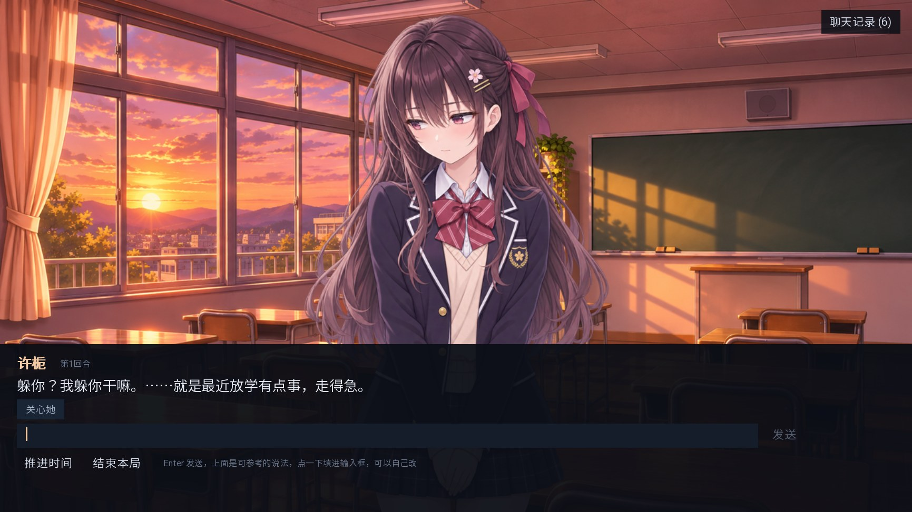

# M1 验收记录（2026-11-16）

对应开发说明 §10 的 M1：接入一个 LLM，给许栀稳定人格与受限已知事实；
`/interact` 用普通 HTTP/JSON 返回完整对白与已校验的状态更新；保存最近对话和重要事件。



## 1. 交付内容

| 项 | 位置 |
|---|---|
| LLM 角色 Agent | `backend/app/agents/llm_character.py` |
| Prompt 组装 | `backend/app/agents/prompts.py` + `content/prompts/character_system.txt` |
| 事件结果规则表 | `backend/app/rules/storylet_resolution.py`（`OUTCOMES`） |
| 结果默认值 | `backend/app/rules/outcome_rules.py` |
| 指标落库 | `backend/app/db.py` 的 `llm_calls` 表 + `Engine._record_llm` |
| 测试 | `tests/test_llm.py`（10 项）+ 原有 37 项 = **47 项** |
| 美术管线 | `art_source/` → `tools/prepare_art.py` → `game/images/`、`game/gui/` |

## 2. 实测证据

### 2.1 真实模型（DeepSeek `deepseek-chat`）

单轮耗时与 token（来自 `llm_calls`）：

```text
calls=2  avg_latency_ms=1663.5  failures=0
prompt_tokens=2783  completion_tokens=104        # 两轮合计
```

典型单轮：**1.5–2.5 秒**，prompt ≈ 1.3–1.5k tokens，输出 ≈ 40–70 tokens。

### 2.2 三条路线的真实对白（原样摘录）

**主动沟通 → romance**（10 轮，约 18 秒模型时间）

```text
你 > 你最近是不是在躲我？
许栀 > 躲你？我躲你干嘛。就是最近事多，懒得看手机而已。

你 > 我那天是在说陈屿他们班的事，真的不是说你。
许栀 > 陈屿他们班……哦，这样啊。

你 > 其实我喜欢你，很久了。
许栀 > ……你、你说什么呢。路灯底下说这种话，你也不怕我当没听见。

你 > 分班的事，你想好了吗？
许栀 > 想好了啊，表格都交了，现在想反悔也来不及了吧。……不过录取名单还没下来，能不能进还两说呢。

=== 结局：下学期，也一起走吧（romance）===
```

**过度干预后补救 → friends**

```text
你 > 分班的事我尊重你，我只想陪你走一段。
许栀 > 陪你走一段……你这话说得，好像明天就见不着了似的。
=== 结局：还是和以前一样（friends）===
```

**持续回避 → missed**

```text
你 > 嗯。
许栀 > 「嗯。」……好，你今天这是要跟我比谁字少是吧。
=== 结局：那天没说出口的话（missed）===
```

对白符合人设：嘴硬、回避、用玩笑挡；没有一次把误会/分班/心意一口气说完。

### 2.3 校验与兜底

| 场景 | 行为 |
|---|---|
| 超时 | `fallback:timeout` → 模板台词，界面不卡死 |
| 坏 JSON | 追加一次"只输出 JSON"修复请求；仍失败 → `fallback:bad_json` |
| 台词为空 | `fallback:empty_dialogue` |
| 台词含"好感度/数值/storylet/AI" | `fallback:leak:*`，台词被丢弃 |
| 模型提议"表白"但玩家没说 | 动作被丢弃（`actions_without_evidence`） |
| 模型提议非法事件结果 | `outcome_not_allowed`，退回规则判定 |

### 2.4 规则与阈值

```text
$ .venv\Scripts\python.exe -m pytest -q
...............................................                          [100%]
[exit=0]     # 47 项
```

测试进程会强制 `ATB_LLM_MODE=mock`，**不会消耗任何 token**。

### 2.5 Ren'Py 客户端（LLM 模式）

```text
$ renpy.exe <repo> lint
Statistics: 0 menus, 5 images, 28 screens        [exit=0]

$ $env:ATB_SELFCHECK="1"; renpy.exe <repo>
health: mode=llm configured=True model=deepseek-chat
boot=True
start_err=None
send_err=None turn=1 version=1
advance_err=None scene=school_gate sprite=xuzhi_normal
chat_log=8
screen_ok res=('quit', None)
ending_screen_ok res=True
done
```

## 3. 关键设计决策

1. **玩家意图以规则为准**：模型的动作提议必须能在玩家这句话里找到依据，否则丢弃。
   这条防线保证"模型不能替玩家表白/替玩家决定"。
2. **事件结果由规则判定**：模型的 `storylet_outcome` 只写进事件日志。
   原因：实测出现过模型把"玩家已解释清楚"判成 `partially_clarified`，导致
   `misunderstanding_resolved=false`、恋爱结局不可达。规则判定 + 事件结果表更可复现。
3. **Prompt 不给数字**：只给"信任较高/亲近感一般"这类定性描述，模型没有数字可说漏。
4. **两次调用封顶**：正常一轮 1 次模型调用；只有坏 JSON 才追加 1 次修复请求。
5. **所有失败都有台词兜底**：先保证界面不死，再谈体验。

## 4. 已知限制

1. 没有流式输出；单轮 1.5–2.5 秒的等待靠"许栀正在回复"提示承载。
2. 导演仍是确定性打分（M2 接 LLM）。
3. 模型的 event outcome 仅记录不提交（见上，等 M2 加更细的证据校验）。
4. 关键词解析对隐晦表达会漏，状态推进偏保守。
5. 中文输入法仅桌面版验证；未做 Web 端 IME/CORS 实测。

## 5. 下一步（M2）

1. `narrative/director.py` 接 LLM：只喂合法候选 + 节奏预算，让它在 `no_event` 与候选中选。
2. 规划结果带 `state_version`，激活前复核；过时则丢弃并记录。
3. 让模型的事件结果提议在"证据充分"时参与判定（例如玩家确实解释了才允许 `clarified`）。
4. 指标面板：每局延迟 P50/P95、调用数、token、失败原因分布。
