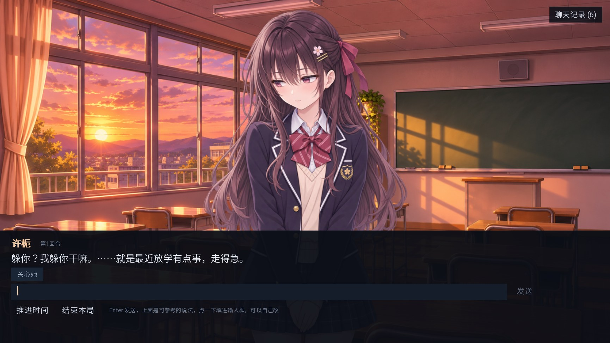

# M2 验收记录（2026-11-17）

对应开发说明 §10 的 M2：关键节点才调用 Director；先从合法 Storylets 选取，允许 `no_event`；
建议事件排期为 `scheduled`，到合适场景再激活；规划带版本号，晚到的旧结果必须重新校验。
**另外吸收了试玩反馈的两条体验问题：台词太刻薄、回答不好接话。**



## 1. 这一版新增/修改

| 项 | 内容 | 位置 |
|---|---|---|
| LLM 导演 | 在规则过滤后的候选里选事件或 `no_event`，附理由；失败退回确定性打分 | `backend/app/narrative/director_llm.py` |
| 触发收紧 | 只在「事件刚结束 / 主动推进 / 临近收尾 / 连续几轮没有事件」时规划 | `narrative/director.py` |
| 版本复核 | 选择前后比对 `state_version`，候选失效或版本变化就丢弃；排期带 `scheduled_at_version` | `narrative/scheduler.py` |
| 建议回复 | 规则生成 2–4 句「可以这么说」，点击填入输入框、可自行修改 | `backend/app/rules/suggestions.py` + `game/chat_screen.rpy` |
| 语气约束 | system prompt 增加「嘴硬可以、刻薄不行」；硬性要求「每句留一个可接的话头」 | `content/prompts/character_system.txt`、`agents/prompts.py` |
| 刻薄兜底 | 台词命中攻击性词（滚/少管/关你什么事…）先要求重写一次，仍不改则退回模板 | `agents/llm_character.py` |
| UI 改版 | 角色对白 / 旁白 / 建议 / 输入全部移到底部；聊天记录改为按钮展开 | `game/chat_screen.rpy` |
| 测试 | 新增 14 项：导演选择/拒绝非法/超时兜底/版本失效、建议回复、刻薄重写 | `tests/test_m2.py` |

## 2. 导演实测（DeepSeek）

真实一局里导演给出的决策与理由（来自 `/events` 的 `kind=director`）：

```text
director scheduled late_explanation
  reason: 连续几轮没有事件
  director_reason: 玩家刚把「那句话」摆上台面，她主动提起那天听见那句话，正好承接并推进澄清误会的目标。

director scheduled old_note
  reason: storylet_resolved
  director_reason: 误会已澄清，便签自然带出旧线索，为分班与关系抉择做铺垫，且不重复刚演过的解释类对话。

director scheduled walk_home
  reason: storylet_resolved
  director_reason: 误会与分班已谈开，校门口路灯下的停顿正好把话题引向两人关系定位，推进唯一未完成目标。
```

说明它真的在「读局面、选下一步」，而不是按固定顺序播事件。

调用指标（6 轮对话：6 次角色 + 4 次导演）：

```text
calls=10  avg_latency_ms=1589.7  failures=0
prompt_tokens=15072  completion_tokens=457
```

- 普通对话仍然只有 1 次角色调用；导演只在关键节点出现（约每 2–3 轮一次）。
- 导演失败/超时/选了不存在的 id → 退回确定性打分，本回合对白不受影响。

## 3. 试玩反馈的处理

### 3.1 “回答太刻薄”

- Prompt 明确区分：**嘴硬是保护色，不是伤人**；列出禁止词；给「好/不好」的对照例子。
- 生成后检查攻击性词，命中先重写一次（只多 1 次调用），仍不改则用模板兜底，保证不把伤人台词送到玩家面前。
- 实测对「你不许去重点班」的回应从命令式变成：
  「陪我走一段……你这话怎么听着跟要告别似的。算了，我先不问。不过我拉链还没拉好呢，你等我一下？」

### 3.2 “不知道该怎么接话 / 不知道怎么推动剧情”

- 每轮返回 2–4 条**建议回复**（规则生成，不是模型编的），直接显示在输入框上方：
  - 新局：「问她怎么了」「聊分班」
  - 误会进入讨论：「澄清误会」
  - 校门口收尾：「说出心意」「先说做朋友」「给她时间」
- 点一下把整句填进输入框，玩家可以改任意字再发——保留自由输入，不变成选项分支。
- Prompt 同时要求：每句台词必须留一个问题 / 没说完的动作 / 可追问的细节；实测回应里出现了「你从哪看出来的？」「那要是没考上呢，你也这么说？」这类可接的点。

## 4. 自动化证据

```text
$ .venv\Scripts\python.exe -m pytest -q
.............................................................            [100%]
[exit=0]     # 61 项

$ renpy.exe <repo> lint
Statistics: 0 menus, 5 images, 29 screens
[exit=0]
```

客户端自检（真模型 + 真实窗口）：

```text
boot=True
send_err=None turn=1 version=1
advance_err=None scene=school_gate sprite=xuzhi_normal
chat_log=7 suggestions=2
screen_ok res=('quit', None)
ending_begin
ending_screen_ok res=True
done
```

三条路线实跑（真模型 + LLM 导演）：

| 路线 | 结局 |
|---|---|
| 主动沟通 | `romance`《下学期，也一起走吧》 |
| 过度干预后补救 | `friends`《还是和以前一样》 |
| 持续回避 | `missed`《那天没说出口的话》 |

新增测试覆盖：

- 导演选合法候选 / 选 `no_event` / 拒绝非法 id / 超时退回 / 关闭开关后走确定性；
- 选完之后状态版本变化 → 调度器丢弃该决定；
- 建议回复：新局、事件中、结局前、全部事实完成后都有可接的话，且去重、≤4 条；
- 刻薄台词触发重写；重写仍刻薄则 `fallback:too_harsh`。

## 5. 设计取舍

1. **导演同步执行，而不是后台线程**：只放在关键节点（约每 2–3 轮一次），普通对话不受影响；
   换来的是实现简单、时序确定、版本复核可测。代价是这些回合会多 1–2 秒等待。
   如果后续要更顺滑，可以把导演放到 `/interact` 返回之后的后台任务，再在下一轮激活前复核版本。
2. **事件结果仍由规则判定**：模型的事件结果提议只写日志。M1 实测过模型会把「已经解释清楚」判成
   「只说开一半」，导致恋爱结局不可达；规则更可复现。
3. **建议回复是规则生成的**：不调用模型，状态相同则结果稳定，便于测试；它只是「提示」，不是「选项」。
4. **刻薄兜底选择「宁可平淡，也不伤人」**：第二次仍不合格就退回模板对白。

## 6. 已知限制

1. 导演仍是请求内同步，关键回合会多 1–2 秒。
2. 建议回复基于规则，同一状态下句子固定，可能重复。
3. 关键词解析对很隐晦的表达会漏，状态推进偏保守。
4. 中文输入法仍只在 Windows 桌面版验证；未做 Web 端实测。
5. 无流式输出。

## 7. 下一步（M3）

1. 结局铺垫节奏与指标面板（延迟 P50/P95、调用数、token、失败原因）。
2. 消融对照：纯 LLM / LLM+Storylet / LLM+Storylet+Director 的推进与收束差异。
3. 导演异步化 + 更细的证据校验，让模型的事件结果提议在证据充分时参与判定。
4. 真人 15–20 分钟时长测试。
