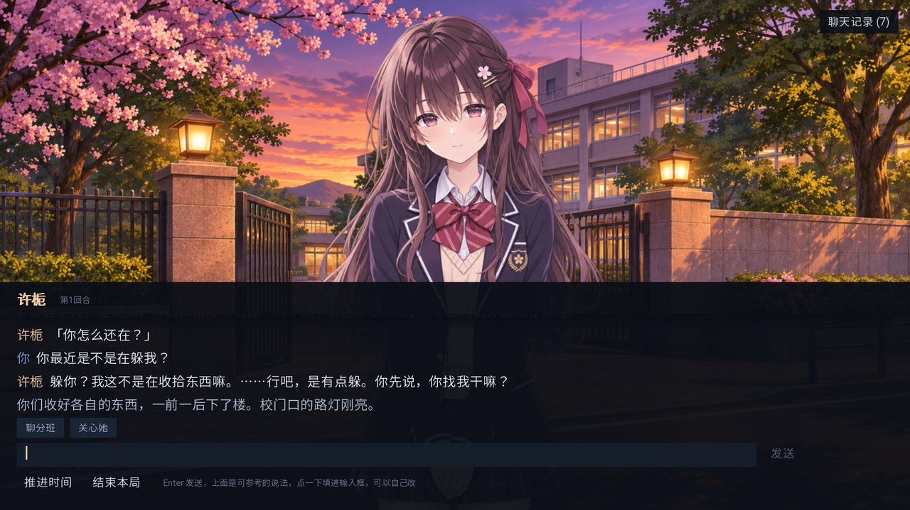
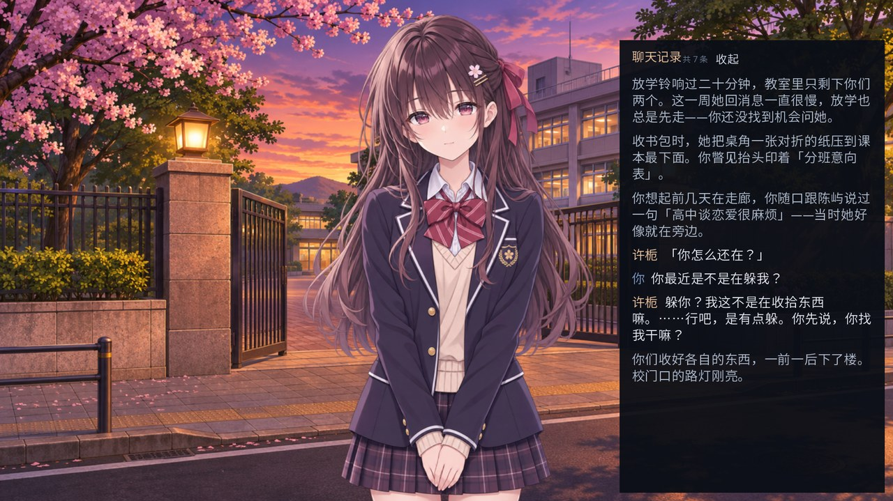
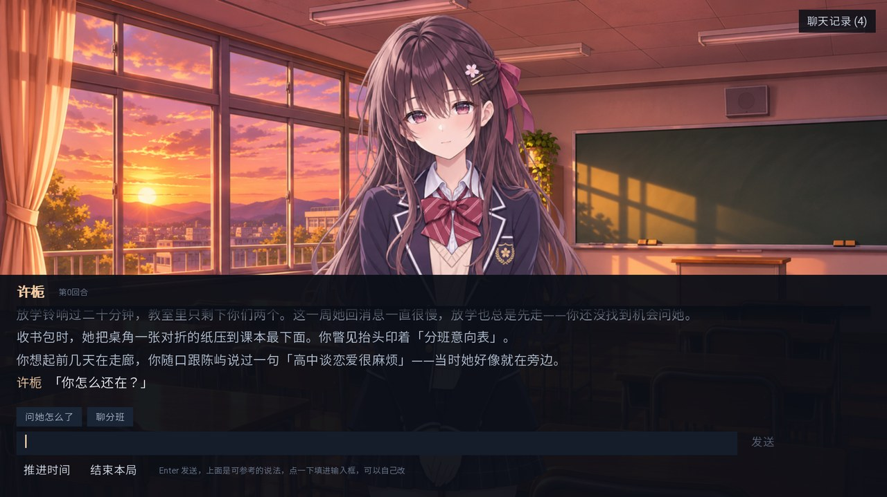

# M3 验收记录（2026-11-17）

对应开发说明 §10 的 M3：结局收束、重要记忆、事件日志、错误兜底、边界测试、
以及 §11 的展示数据（响应时间 / 调用数 / Token / 三路线差异 / 消融对照）。
**另外按试玩反馈重做了界面：女主居中，聊天记录收进右上角按钮，展开不遮人。**





## 0. 试玩反馈的两处修正（本轮追加）

### 0.1 背景信息要交代清楚

之前的问题是：事件库默认玩家已经知道「那句话」和「分班」，但玩家其实不知道。现在做了三层铺垫：

1. **开场旁白**（3 句，直接进聊天记录）：
   - 这一周她回消息慢、放学先走；
   - 她桌角压着一张「分班意向表」，玩家只看到抬头；
   - 玩家想起前几天在走廊对陈屿说过「高中谈恋爱很麻烦」，当时她好像在旁边。
2. **事件自带背景旁白**：`storylets.json` 新增 `exposition` 字段，事件激活时先播背景再播情境：
   - `late_explanation`：「你当时只是随口抱怨陈屿他们班的八卦，并不是在说许栀。」
   - `class_choice`：「那张表就是刚才她往课本底下压的那张，抬头印着『分班意向表』。」
3. **角色 Prompt** 增加「玩家目前知道的」小节，并要求：第一次提到「那句话 / 分班」时，
   必须用一句自然的话把具体内容带出来（比如「你在走廊跟陈屿说的那句」），不要让玩家猜。

实测回应会主动对齐背景：

```text
你 > 我想问问，是不是跟那句话有关？
许栀 > 哪句啊？你哪天说的话可多了。……你说的是走廊上跟陈屿那句，还是别的？
```



### 0.2 旁白更醒目

- 旁白字号 16 → **19**，取消斜体，颜色调亮为 `#b3c0d2`（与角色对白、玩家发言同字号，但用颜色区分）。
- 对话区高度 306 → 322，可视行数增加。
- 聊天记录顶部加四层渐隐：旧消息被裁切时自然淡出，不再出现"半行字"。


## 1. 这一版新增

| 项 | 内容 | 位置 |
|---|---|---|
| 指标面板 | `GET /game/{id}/metrics`：按 `purpose`（角色/导演）统计调用数、失败数、P50/P95/max 延迟、token、失败原因分布 + 本局进度 | `db.llm_stats`、`engine.get_metrics`、`main.py` |
| 兜底收束 | 到达硬上限仍未触发 finale（或消融关掉 Storylet）→ 强制走结局，绝不无限聊 | `engine.py` §9.5 |
| 消融开关 | `ATB_STORYLETS=0` 关掉全部事件，用于「纯 LLM 聊天」对照组 | `config.py` |
| 消融工具 | `tools/ablation.py`：同一脚本跑三种模式，输出 Markdown 表 | `docs/ABLATION.md` |
| 边界测试 | 沉默输入、连续刷「嗯」、关闭 Storylet 仍要收束、指标不泄露给玩家 | `tests/test_m3.py` |
| UI | 女主居中；「聊天记录」按钮移到右上角；展开为右侧抽屉（不遮人物），收起恢复输入 | `game/chat_screen.rpy` |

## 2. 消融对照（真实模型，communicate 路线）

```text
| 模式 | 结局 | 回合 | 有效互动 | 触发事件 | LLM 调用 | prompt tokens | 角色均值/P95 (ms) |
| 纯 LLM 聊天 | friends | 11 | 9 | — | 11 | 22292 | 1503.6 / 1687 |
| + 条件 Storylet | romance | 10 | 8 | late_explanation、direct_question、walk_home、class_choice、school_gate_finale | 10 | 20068 | 1495.0 / 1905 |
| + LLM 导演 | romance | 10 | 8 | late_explanation、old_note、walk_home、class_choice、school_gate_finale | 15 | 24493 | 1424.7 / 1609 |
```

结论（以这次实测为准）：

1. **纯 LLM 聊天**：对白自然，但没有任何机制把「那句话」摆上桌，`misunderstanding_resolved` 永远是 false，
   同一套玩家话术只能收在 **friends**。
2. **+ 条件 Storylet**：事件把关键话题变成可交互场景，同一条路线可以走到 **romance**。
3. **+ LLM 导演**：结局相同，但选的事件集合不同（用 `old_note` 替换了 `direct_question`），
   代价是多 5 次导演调用（prompt 多约 4.4k tokens）。
   导演的价值在"顺序与节奏可解释"，不在"必然改变结局"。

复现命令：

```powershell
.venv\Scripts\python.exe tools\ablation.py --routes communicate --out docs/ABLATION.md
```

## 3. 指标（真实一局，含导演）

```text
$ curl http://127.0.0.1:8756/game/<id>/metrics
{
  "by_purpose": {
    "character": { "calls": 10, "failures": 0, "p50_latency_ms": ..., "p95_latency_ms": ..., "prompt_tokens": ... },
    "director":  { "calls": 5,  "failures": 0, "p50_latency_ms": ..., "p95_latency_ms": ..., "prompt_tokens": ... }
  },
  "totals": { "calls": 15, "failures": 0, "prompt_tokens": ..., "completion_tokens": ... },
  "errors": {},
  "session": { "turn_index": 10, "meaningful_turns": 8, "ending_phase": "committed", "ending_id": "romance", ... }
}
```

指标只通过 `/metrics` 给开发者，不进玩家可见响应（有测试保证）。

## 4. 边界与兜底

| 场景 | 行为 |
|---|---|
| 玩家只发「……」（沉默） | 正常回一句、回合照常推进，不崩 |
| 连续 40 轮「嗯。」 | 到硬上限强制收束（测试断言 `committed`） |
| 关掉 Storylet（纯 LLM 模式） | 到软上限走兜底结局，事件列表为空 |
| 导演选了不存在的 id | 退回确定性打分 |
| 选完之后状态版本变化 | 丢弃该排期 |
| 模型返回坏 JSON / 超时 / 刻薄 | 重试 / 重写 / 模板兜底 |

## 5. 自动化证据

```text
$ .venv\Scripts\python.exe -m pytest -q
...................................................................      [100%]
[exit=0]     # 67 项

$ D:\renpy-8.6.0-sdk\renpy.exe D:\AfterTheBell lint
Statistics: 0 menus, 5 images, 29 screens
[exit=0]
```

客户端自检（真模型，两种界面状态都截图）：

```text
boot=True
send_err=None turn=1 version=1
advance_err=None scene=school_gate sprite=xuzhi_normal
chat_log=7 suggestions=2
screen_ok res=('quit', None)
log_screen_ok res=('quit', None)
ending_begin
ending_screen_ok res=True
done
```

三条路线实跑（真模型 + LLM 导演）：

| 路线 | 结局 |
|---|---|
| 主动沟通 | `romance`《下学期，也一起走吧》 |
| 过度干预后补救 | `friends`《还是和以前一样》 |
| 持续回避 | `missed`《那天没说出口的话》 |

## 6. 已知限制

1. **没有真人 15–20 分钟时长测试**：脚本路线约 10–11 轮，真人自由发挥的时长未测。
2. 导演仍是请求内同步：带导演的回合多 1–2 秒。
3. 建议回复是规则生成的，可能重复。
4. 事件结果仍由规则判定（模型的 `storylet_outcome` 只写日志）。
5. 中文输入法只在 Windows 桌面版验证；Web 端未测。
6. 无流式输出。

## 7. 剩余工作（超出 M3 验收）

1. 真人时长与节奏测试（需要你实际玩几局）。
2. 导演异步化（返回后台规划 + 下一轮激活前复核）。
3. Web 端适配：`renpy.fetch`、中文输入、HTTPS/CORS。
4. 让模型的事件结果提议在证据充分时参与判定。
